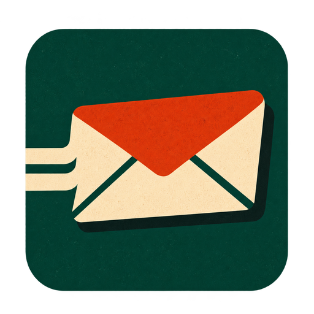

<p align="center"></p>
<h1 align="center">Slop Mail</h1>
<p align="center"><samp>AIR MAIL · macOS / Windows</samp></p>
<p align="center">English · <a href="README.ru.md">Русский</a></p>
<p align="center"><a href="https://github.com/Lanakod/slop-mail/releases/latest"></a> <a href="https://github.com/Lanakod/slop-mail/actions/workflows/desktop.yml"></a> <a href="https://github.com/Lanakod/slop-mail/blob/master/LICENSE"></a></p>

Slop Mail is a local-first desktop mail client that presents email threads as conversations. Keep a thread open for quick replies, or pop out a separate window to compose a new message. Once your mailbox has synced, you can search messages, open downloaded attachments and write drafts offline.

Lanakod develops Slop Mail together with OpenAI Codex, from shaping features to writing code and testing releases. The name **Slop Mail** is a wink at that collaboration.

## First delivery

1. Download the DMG for Apple Silicon Macs or the installer for 64-bit Windows. On macOS, drag Slop Mail into Applications. [GitHub Releases](https://github.com/Lanakod/slop-mail/releases/latest)
2. Create a profile, click **＋** beside the mailboxes and enter your email address. Discover settings from your provider or the Thunderbird configuration directory, choose a saved preset, or enter the servers manually.
3. Test the incoming and outgoing connections, save the account and fetch your mail. The first sync populates your local archive. Configure the polling interval and notifications in Settings.
4. Expand a thread to see its messages. Unread messages appear in bold. Click a message to reply inline. Quoted text collapses separately. Web links open in your browser and mail links open a draft.

## At the mail desk

| Task | How it works |
| --- | --- |
| Triage a busy inbox | Select multiple rows with Ctrl/Cmd-click or a range with Shift-click. Right-click to mark them read, move them, archive them or send them to Trash. IMAP server moves require UID MOVE. POP3 folders are local. |
| Come back to a conversation | Snooze it until a date and time. An incoming reply brings it back early. |
| Find a message | Search offline, combine filters and save a query for later. For example, use `файл:pdf` to look for PDF attachments. Incoming rules can label messages, move them or silence notifications. |
| Write and send | Use bold, italic, lists and links. Drop files onto either editor. A ten-second undo window lets you return a queued message to the editor. |
| Track delivery | The queue shows each recipient’s delivery status. For IMAP accounts it also shows whether the sent copy reached the server folder. Retry saving a copy independently after a failure. POP3 accounts keep a local copy. |
| Manage contacts | Search by name or address, view a contact’s conversations across the profile, create groups and import or export vCard and CSV. Personal mailings create one message per recipient. |
| Keep up with arrivals | IMAP IDLE listens for incoming mail when supported. POP3 and disconnected IMAP sessions use the selected polling interval. Manual mode disables both automatic checks. |

Closing the main window keeps Slop Mail running. On Windows, reopen it from the tray or your shortcut. On macOS, use the Dock. To quit, use the Windows tray menu or ⌘Q.

| Shortcut | Action |
| --- | --- |
| Ctrl/⌘ + N | Compose a message |
| Ctrl/⌘ + F | Search |
| Ctrl/⌘ + R | Focus the quick reply |
| Ctrl/⌘ + Enter | Confirm sending |

## Your mail archive

Each profile has its own `mail.sqlite` database for messages, attachments, contacts, drafts, the delivery queue and full-text search. Saved passwords use macOS Keychain or Windows Credential Manager. You can also keep credentials in memory for the current session.

| System | Default data directory |
| --- | --- |
| macOS | `~/Library/Application Support/org.SlopMail.Slop-Mail/` |
| Windows | `%APPDATA%\SlopMail\Slop Mail\data\` |

Profiles live under `Profiles/<UUID>/` or in a directory of your choice. To move a profile, quit the client, copy the entire profile directory, choose **Open existing profile** on the destination computer and enter your account passwords.

Incoming and outgoing connections support TLS and required STARTTLS (STLS for POP3). POP3 tracks UIDL and issues DELE only after saving a message locally when you choose to remove server copies. HTML mail opens in an isolated frame. Loading external images requires a separate action.

## Workshop

The client uses Rust, Tauri 2, SQLite FTS5 and JavaScript. Development uses Rust 1.95 and Node.js 22.20. On macOS, install Xcode Command Line Tools. On Windows, use the MSVC Rust toolchain, Windows SDK, WebView2 and the Visual Studio Build Tools workload **Desktop development with C++**.

```sh
npm ci
npm run dev
```

| Package | Build command |
| --- | --- |
| macOS arm64 disk image | `sh scripts/package-macos.sh` |
| Windows x64 installer | `npm run build -- --ci --bundles nsis` |

Version tags such as `v0.5.1` trigger CI builds and signed updater packages. The app verifies the update signature before installation. Local Mac builds are not notarized. You can check for updates manually in Settings or choose an interval while the client is running. The default is once a day. Installation asks for confirmation. [Release workflow](.github/workflows/desktop.yml) · [Changelog (Russian)](CHANGELOG.md)

## Contributing

Use the bug report or feature request form to open an issue. The contribution guide has the local checks and conventions for pull requests. [Issue forms](https://github.com/Lanakod/slop-mail/issues/new/choose) · [Contributing](CONTRIBUTING.md)

Copyright © 2026 Lanakod. Distributed under the [MIT License](LICENSE).
